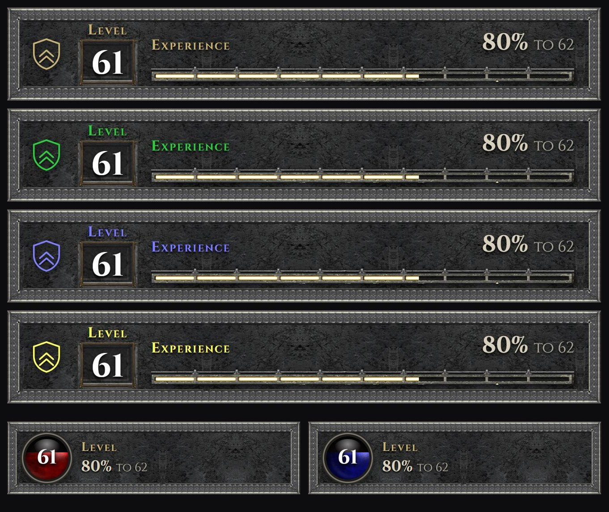

# D2R Level Overlay

**Show your Diablo II: Resurrected character level and XP bar live on stream, with a level-up animation.**
It reads the game *from the screen*, the same way OBS captures it — no memory reading, nothing injected, nothing sent to the game.

[Leia em português](README.pt-BR.md)



- Level and XP progress update every second while you play
- Level-up animation (bar fills, bursts, the number jumps)
- Works with any language of the game (it never reads words), at 16:9 resolutions
- A **Diablo II look** out of the box: the game's steel XP bar with its iron spikes, stone panels with golden corners, small caps like the game's titles, item-quality colors (unique, set, magic, rare) and a life/mana **orb**
- Fully customizable: 5 layouts, 12 presets, colors, fonts (any Google Font), labels in 8 languages or your own words
- A configurator page with live preview that gives you the address to paste into OBS
- Fits any browser-source size, on any OBS canvas

---

## Safety: it does not touch the game

This was the first requirement. The overlay only **looks at pixels already on your screen**, like Print Screen, OBS display capture or a screenshot tool.

**What it does**, once per second, and only while Diablo II: Resurrected is the window in front:

| Windows call | What for |
|---|---|
| `GetForegroundWindow`, `GetWindowThreadProcessId` | Is the window in front the game's? |
| `GetClientRect`, `ClientToScreen` | Where is the game on screen and how big is it? |
| `Graphics.CopyFromScreen` | Copy one rectangle of the desktop image; four small areas of it are used (XP bar, the two level-up buttons, one line of the character screen) |
| `Process.GetProcessesByName("D2R")` | Is the game running? (process ids from the system list) |
| `SetThreadDpiAwarenessContext` | Real pixels on scaled displays (affects only its own thread) |

**What it never does:** open the game process, read or write its memory, inject a DLL or hook anything, send keys or clicks, read or change the game's files, or talk to any server. The copied pixels stay in memory for that one second and are never saved or sent anywhere.

**It is checked, not just promised.** `streamerbot/build.py` refuses to build the Streamer.bot package if the code uses any Windows call outside the five above, or anything able to touch another process or simulate input (`OpenProcess`, `ReadProcessMemory`, `WriteProcessMemory`, `CreateRemoteThread`, `SetWindowsHookEx`, `SendInput`, `PostMessage`, `SendMessage`, `LoadLibrary`, `Process.MainModule`, `Process.Handle`, file and network access, …). The tests prove the check rejects such code.

**About the anti-cheat.** Warden and the rest of Blizzard's anti-cheat look for programs that read or change the game, inject code or automate input. This overlay does none of that: from the game's point of view nothing happens at all, just as with OBS capturing your screen. We cannot speak for Blizzard; read the code (it is short) and decide for yourself. This project is not affiliated with or endorsed by Blizzard Entertainment.

**Performance.** One screen copy per second on a background thread of Streamer.bot: about 35 ms of one CPU core per second at 1920 × 1080 (median measured while playing), almost all of it the copy itself; the reading takes under 1 ms. No FPS change was noticed while testing during play.

## How it works

Everything is matched against pictures of the game's own interface, never against text:

1. **XP bar** of the HUD: how far the white fill goes is your progress inside the level.
2. **HUD frame**: the metal frame around the XP bar is fixed art. When it is not there (loading screens, menus, a popup on top), that second is ignored.
3. **Level-up buttons**: the red squares with a golden cross ("New Stats" / "New Skill"), matched as images.
4. **Character screen**: the XP line ends with the experience needed for the next level ("… of 128,782,495"). That number is read digit by digit and looked up in the Diablo II experience table, which gives the exact level in any language.

A **level up** is counted when the XP bar drops by 30 % or more and stays down on the next second, *and* a level-up button is on screen (or the character screen is open, since it covers the left button). The buttons alone never count: they also come back when a panel closes or when you join a game with unspent points. Whenever the character screen is open, its level wins.

## Requirements

- Windows 10 or 11, with the game and Streamer.bot **on the same PC** (two-PC setups: run Streamer.bot on the gaming PC)
- [Streamer.bot](https://streamer.bot) 1.0 or newer, with its WebSocket server enabled
- OBS Studio (any version with Browser sources)
- Diablo II: Resurrected in a **16:9** resolution, fullscreen or windowed, any monitor, with the default interface (not "Legacy graphics" for the interface, not "Low vision mode")

| Game resolution | Status |
|---|---|
| 2560 × 1440 | tested in real play |
| 1920 × 1080 | tested in real play |
| 3840 × 2160 | tested with resized captures |
| other 16:9 | should work (same proportions) |
| 21:9, 16:10, … | not supported yet: please record samples (see below) |

## Install

### 1. Streamer.bot

1. **Servers/Clients → WebSocket Server**: enable *Auto Start* and start it (default address `127.0.0.1`, port `8080`).
2. **Import** (top of the window): paste the content of [`streamerbot/D2R-Level-Overlay.sb`](streamerbot/D2R-Level-Overlay.sb) and import it.
   It adds one action, **D2R Level**, and one chat command, **!level**.
3. **Commands**: Streamer.bot imports commands disabled. Enable **D2R Level !level** if you want it.
4. Restart Streamer.bot once (or run the action once): the reader starts with Streamer.bot from then on.

### 2. The overlay in OBS

1. Open [`overlay/configure.html`](overlay/configure.html) in your browser (double-click it after downloading the repository).
2. Pick the layout, colors, fonts and language; test a level up in the preview.
3. In OBS, add a **Browser** source, leave **Local file unchecked**, paste the address from the configurator into **URL**, and use the suggested width and height.

### 3. Tell it your level

Open the character screen (**C**) once in game: the level is read from it. From then on level ups are counted automatically (and corrected whenever you open the character screen again). Or type `!level 62` in chat.

## The game's own textures

The Diablo II presets use pieces of the **game's own interface** from `overlay/textures/`: the
engraved window frame, the dark stone, the gold-trimmed box, the real HUD XP bar with its iron
spikes and the life and mana globes. They were cut from screenshots of the game at 2560 × 1440.
Add `textures=0` to the address for the same presets drawn in code instead.

To make them again from your own screenshots (another resolution, or just to refresh them):

```
python tools/make_textures.py --character panel.png --gold gold.png --hud-low low.png --hud-high high.png --screen game.png
```

`--help` explains each picture it needs.

## Chat command

`!level 62` sets the level, `!level +` / `!level -` add or subtract one. Broadcaster and moderators only (Twitch).

## Customizing

Everything is in the configurator. For reference, the overlay address accepts:

| Parameter | Values | |
|---|---|---|
| `preset` | Diablo II: `unique` (default), `set`, `magic`, `rare`, `life`, `mana`; others: `sanctuary`, `blood`, `frost`, `clean`, `neon`, `pixel` | starting point for the look |
| `layout` | `classic`, `stacked`, `medallion`, `orb`, `minimal` | |
| `bar` | `segments`, `solid`, `none` | XP bar fill |
| `frame` | `plain`, `d2` | XP bar frame (`d2`: steel frame with iron spikes, like the game) |
| `caps` | `upper`, `small` | labels in spaced capitals or in small caps like the game |
| `lang` | `en`, `pt-BR`, `es`, `fr`, `de`, `it`, `pl`, `ru` | label language |
| `labelLevel`, `labelXp`, `labelUp` | any text | your own words |
| `accent`, `text`, `number`, `glow`, `fill1`, `fill2`, `track` | hex color without `#` | |
| `fontLabel`, `fontNumber`, `fontText` | any Google Fonts family | |
| `panel`, `panelStyle`, `panelColor`, `panelAlpha`, `radius` | `0`/`1`, `flat`/`stone`, color, `0`–`1`, px | background panel (`stone`: Diablo II stone with golden corners) |
| `pct`, `next`, `icon`, `shadow`, `anim`, `hide` | `0`/`1` | percentage, "to next level", icon, text shadow, animation, hide while the game is closed |
| `align` | `left`, `center`, `right` | position inside a wider source |
| `host`, `port`, `pass` | | Streamer.bot WebSocket server (password only if you enabled one) |
| `demo` | `1` | fake data, for testing without Streamer.bot |

## Troubleshooting

- **Streamer.bot log** (Logs tab): lines starting with `[D2R Level]` say when the game opens or closes, each level up and why, and warnings such as an unsupported resolution.
- **Variables → Globals**: `d2r_level` is the saved level; `d2r_level_state` is what the last second saw (`hud, xp 0.37, New Skill button, character screen: level 62`).
- The game must be the **window in front** — when you alt-tab, it simply waits.
- Nothing happens at all? Check that the WebSocket server is running and that the overlay address uses the same port.

## Help it support your setup

Unsupported resolution, odd results, another language? Record samples while playing and open an issue with them:

```
python tools/record_samples.py 20
```

It saves small pieces of the screen (only the XP bar area with the level-up buttons, and the top of the character screen) into `samples/`, and only while the game is the window in front. Level up once without spending the points right away and open the character screen a few times. Needs Python 3 with Pillow and NumPy.

## For developers

```
python streamerbot/build.py               # safety check, compile check, writes D2R-Level-Overlay.sb
python streamerbot/tests/test_reader.py   # the real C# on recorded screens + the level-up rules
```

- `streamerbot/src/Reader.cs` — the reader and the level-up rules (pure logic, testable)
- `streamerbot/src/Action.cs` — the Streamer.bot action (screen copy, chat command, WebSocket broadcast)
- `streamerbot/templates/` — the reference pictures (from a 2560 × 1440 screen)
- `streamerbot/tests/fixtures/` — recorded screen pieces with the expected readings
- `overlay/` — `index.html` (the overlay), `configure.html` (the configurator), `shared.js` (options, presets, languages), `textures/` (pieces of the game's interface)
- `tools/` — `record_samples.py` (screen samples for calibration), `make_textures.py` (textures from your screenshots)

The overlay listens to the Streamer.bot broadcast `{"d2r_level": {"level": 62, "xp": 0.35, "levelUp": false, "running": true}}`, so you can also build your own.

## License

[MIT](LICENSE) for the code. The textures in `overlay/textures/` and the screen pieces used as test fixtures (`streamerbot/templates/`, `streamerbot/tests/fixtures/`) come from Diablo II: Resurrected and are © Blizzard Entertainment, Inc.; they are not covered by the MIT license and are here only so this free, non-commercial fan tool can look and work like the game. Diablo and Diablo II: Resurrected are trademarks of Blizzard Entertainment, Inc. This is an unofficial fan project, not affiliated with or endorsed by Blizzard; any of this material will be removed on request.
