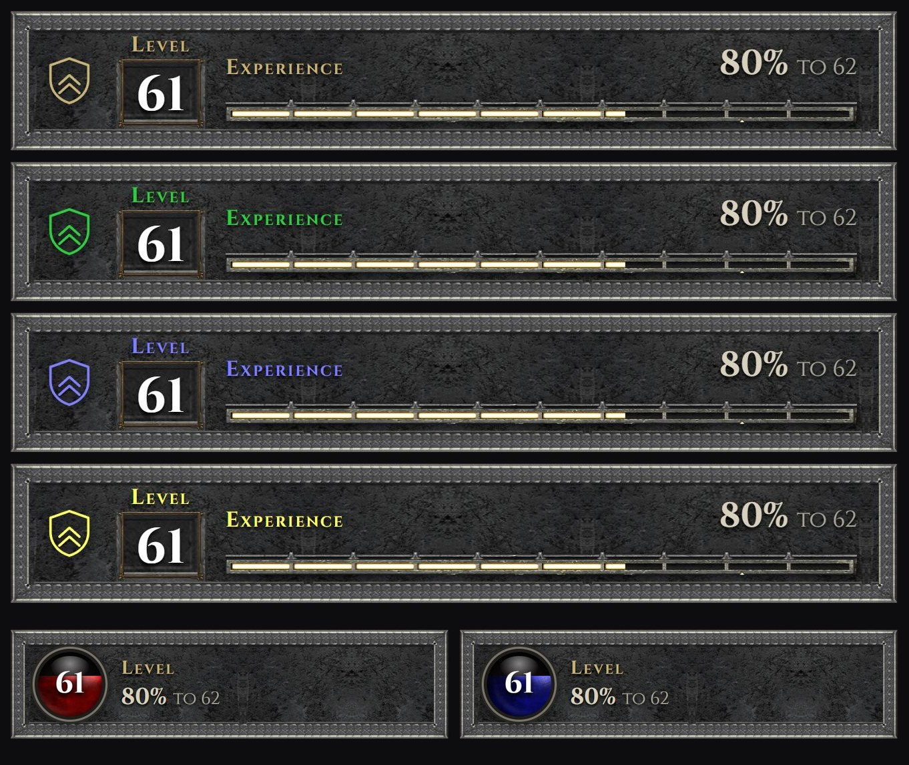

# D2R Level Overlay

**Mostre o nível e a barra de XP do seu personagem de Diablo II: Resurrected ao vivo na stream, com animação quando sobe de nível.**
Ele lê o jogo *pela tela*, do mesmo jeito que o OBS captura: não lê memória, não injeta nada, não manda nada para o jogo.

[Read in English](README.md)



- Nível e progresso de XP atualizados a cada segundo enquanto você joga
- Animação de subir de nível (a barra enche, estoura e o número salta)
- Funciona com o jogo em qualquer idioma (ele nunca lê palavras), em resoluções 16:9
- **Visual de Diablo II** pronto: a barra de XP de metal do jogo com as pontas de ferro, painéis de pedra com cantoneiras douradas, versalete como os títulos do jogo, as cores de raridade dos itens (único, conjunto, mágico, raro) e um **orbe** de vida/mana
- Visual todo configurável: 5 desenhos, 12 estilos prontos, cores, fontes (qualquer Google Font) e textos em 8 idiomas ou com as suas palavras
- Uma página de configuração com prévia ao vivo, que entrega o endereço para colar no OBS
- Cabe em qualquer tamanho de fonte de navegador, em qualquer tela do OBS

---

## Segurança: ele não mexe no jogo

Este foi o primeiro requisito. O overlay só **olha os pixels que já estão na sua tela**, como o Print Screen, a captura de tela do OBS ou um programa de screenshot.

**O que ele faz**, uma vez por segundo e só quando o Diablo II: Resurrected é a janela da frente:

| Chamada do Windows | Para quê |
|---|---|
| `GetForegroundWindow`, `GetWindowThreadProcessId` | A janela da frente é a do jogo? |
| `GetClientRect`, `ClientToScreen` | Onde o jogo está na tela e qual o tamanho? |
| `Graphics.CopyFromScreen` | Copiar um retângulo da imagem da área de trabalho, do qual só quatro áreas pequenas são usadas (a barra de XP, os dois botões de subir de nível e uma linha da tela do personagem) |
| `Process.GetProcessesByName("D2R")` | O jogo está aberto? (números de processo da lista do sistema) |
| `SetThreadDpiAwarenessContext` | Pixels reais em telas com escala (vale só para a própria thread) |

**O que ele nunca faz:** abrir o processo do jogo, ler ou escrever na memória dele, injetar DLL ou "hook", mandar teclas ou cliques, ler ou alterar arquivos do jogo, ou falar com qualquer servidor. Os pixels copiados ficam na memória durante aquele segundo e nunca são salvos nem enviados.

**Isso é conferido, não só prometido.** O `streamerbot/build.py` se recusa a gerar o pacote do Streamer.bot se o código usar qualquer chamada do Windows fora das cinco acima, ou qualquer coisa capaz de mexer em outro processo ou simular entrada (`OpenProcess`, `ReadProcessMemory`, `WriteProcessMemory`, `CreateRemoteThread`, `SetWindowsHookEx`, `SendInput`, `PostMessage`, `SendMessage`, `LoadLibrary`, `Process.MainModule`, `Process.Handle`, acesso a arquivos e à rede, …). Os testes provam que essa checagem recusa código assim.

**Sobre o anticheat.** O Warden e o resto do anticheat da Blizzard procuram programas que leem ou alteram o jogo, injetam código ou automatizam comandos. Este overlay não faz nada disso: do ponto de vista do jogo, nada acontece, como com o OBS capturando a tela. Não podemos falar pela Blizzard; leia o código (é curto) e decida. Este projeto não tem ligação nem aval da Blizzard Entertainment.

**Desempenho.** Uma cópia da tela por segundo, numa thread separada do Streamer.bot: uns 35 ms de um núcleo por segundo em 1920 × 1080 (mediana medida jogando), quase tudo na própria cópia; a leitura leva menos de 1 ms. Nenhuma mudança de FPS foi notada nos testes jogando.

## Como funciona

Tudo é comparado com imagens da própria interface do jogo, nunca com texto:

1. **Barra de XP** do HUD: até onde vai o branco é o seu progresso dentro do nível.
2. **Moldura do HUD**: a moldura de metal em volta da barra é arte fixa. Quando ela não está lá (carregando, menus, algo por cima), aquele segundo é ignorado.
3. **Botões de subir de nível**: os quadrados vermelhos com a cruz dourada ("New Stats" / "New Skill"), comparados como imagem.
4. **Tela do personagem**: a linha de XP termina com a experiência do próximo nível ("… of 128.782.495"). Esse número é lido dígito a dígito e procurado na tabela de experiência do Diablo II, o que dá o nível exato em qualquer idioma.

Uma **subida de nível** conta quando a barra de XP cai 30 % ou mais e continua embaixo no segundo seguinte, *e* um botão de subir de nível está na tela (ou a tela do personagem está aberta, porque ela cobre o botão da esquerda). Os botões sozinhos nunca contam: eles também voltam quando um painel fecha ou quando você entra no jogo com pontos guardados. Sempre que a tela do personagem estiver aberta, vale o nível dela.

## Requisitos

- Windows 10 ou 11, com o jogo e o Streamer.bot **no mesmo PC** (quem usa dois PCs: rode o Streamer.bot no PC do jogo)
- [Streamer.bot](https://streamer.bot) 1.0 ou mais novo, com o servidor WebSocket ligado
- OBS Studio (qualquer versão com fonte de navegador)
- Diablo II: Resurrected numa resolução **16:9**, tela cheia ou janela, em qualquer monitor, com a interface padrão (sem "gráficos antigos" na interface e sem o "modo de baixa visão")

| Resolução do jogo | Situação |
|---|---|
| 2560 × 1440 | testado jogando |
| 1920 × 1080 | testado jogando |
| 3840 × 2160 | testado com capturas redimensionadas |
| outras 16:9 | devem funcionar (mesmas proporções) |
| 21:9, 16:10, … | ainda não: grave amostras (veja abaixo) |

## Instalação

### 1. Streamer.bot

1. **Servers/Clients → WebSocket Server**: ligue o *Auto Start* e inicie (endereço padrão `127.0.0.1`, porta `8080`).
2. **Import** (no alto da janela): cole o conteúdo de [`streamerbot/D2R-Level-Overlay.sb`](streamerbot/D2R-Level-Overlay.sb) e importe.
   Entra uma ação, **D2R Level**, e um comando de chat, **!level**.
3. **Commands**: o Streamer.bot importa comandos desligados. Ligue o **D2R Level !level** se quiser usá-lo.
4. Reinicie o Streamer.bot uma vez (ou rode a ação uma vez): daí em diante o leitor liga junto com ele.

### 2. O overlay no OBS

1. Abra o [`overlay/configure.html`](overlay/configure.html) no navegador (dois cliques nele depois de baixar o repositório).
2. Escolha desenho, cores, fontes e idioma; teste uma subida de nível na prévia.
3. No OBS, adicione uma fonte **Navegador**, deixe **Arquivo local desmarcado**, cole em **URL** o endereço do configurador e use a largura e a altura sugeridas.

### 3. Diga o seu nível

Abra a tela do personagem (**C**) uma vez no jogo: o nível é lido dela. Daí em diante as subidas são contadas sozinhas (e corrigidas sempre que você abre a tela do personagem de novo). Ou digite `!level 62` no chat.

## As texturas do próprio jogo (opcional)

Os estilos Diablo II já parecem o jogo, desenhados em código. Eles também podem usar a **arte do
próprio jogo** — a moldura gravada das janelas, a pedra, a caixa com moldura dourada, a barra de XP
de verdade com as pontas de ferro e os globos de vida e mana — feita a partir dos **seus próprios
prints**:

```
python tools/make_textures.py --character painel.png --gold ouro.png --hud-low baixa.png --hud-high alta.png --screen jogo.png
```

O script explica cada imagem de que precisa (`--help`). Ele grava tudo em `overlay/textures/`, e o
overlay usa as texturas quando elas estão lá. **Elas são arte da Blizzard, então não fazem parte
deste repositório** (`overlay/textures/` é ignorada pelo git): cada streamer faz as suas a partir do
próprio jogo, para a própria live.

## Comando de chat

`!level 62` define o nível; `!level +` / `!level -` somam ou tiram um. Só o dono do canal e moderadores (Twitch).

## Personalização

Está tudo no configurador. Para referência, o endereço do overlay aceita:

| Parâmetro | Valores | |
|---|---|---|
| `preset` | Diablo II: `unique` (padrão), `set`, `magic`, `rare`, `life`, `mana`; outros: `sanctuary`, `blood`, `frost`, `clean`, `neon`, `pixel` | ponto de partida do visual |
| `layout` | `classic`, `stacked`, `medallion`, `orb`, `minimal` | |
| `bar` | `segments`, `solid`, `none` | enchimento da barra de XP |
| `frame` | `plain`, `d2` | moldura da barra (`d2`: metal com pontas de ferro, como no jogo) |
| `caps` | `upper`, `small` | textos em maiúsculas espaçadas ou em versalete como no jogo |
| `lang` | `en`, `pt-BR`, `es`, `fr`, `de`, `it`, `pl`, `ru` | idioma dos textos |
| `labelLevel`, `labelXp`, `labelUp` | qualquer texto | as suas palavras |
| `accent`, `text`, `number`, `glow`, `fill1`, `fill2`, `track` | cor em hex sem `#` | |
| `fontLabel`, `fontNumber`, `fontText` | qualquer família do Google Fonts | |
| `panel`, `panelStyle`, `panelColor`, `panelAlpha`, `radius` | `0`/`1`, `flat`/`stone`, cor, `0`–`1`, px | painel de fundo (`stone`: pedra de Diablo II com cantoneiras douradas) |
| `pct`, `next`, `icon`, `shadow`, `anim`, `hide` | `0`/`1` | porcentagem, "para o próximo nível", ícone, sombra do texto, animação, esconder com o jogo fechado |
| `align` | `left`, `center`, `right` | posição dentro de uma fonte mais larga |
| `host`, `port`, `pass` | | servidor WebSocket do Streamer.bot (senha só se você ligou uma) |
| `demo` | `1` | dados de exemplo, para testar sem o Streamer.bot |

## Problemas

- **Log do Streamer.bot** (aba Logs): linhas que começam com `[D2R Level]` dizem quando o jogo abre ou fecha, cada subida e o motivo, e avisos como resolução não suportada.
- **Variables → Globals**: `d2r_level` é o nível guardado; `d2r_level_state` é o que o último segundo viu (`hud, xp 0.37, New Skill button, character screen: level 62`).
- O jogo precisa ser a **janela da frente**: quando você dá alt-tab, ele só espera.
- Nada acontece? Confira se o servidor WebSocket está ligado e se o endereço do overlay usa a mesma porta.

## Ajude a suportar a sua configuração

Resolução não suportada, resultado estranho, outro idioma? Grave amostras jogando e abra uma issue com elas:

```
python tools/record_samples.py 20
```

Ele salva pedaços pequenos da tela (só a área da barra de XP com os botões de subir de nível e o alto da tela do personagem) em `samples/`, e só com o jogo na janela da frente. Suba de nível uma vez sem gastar os pontos na hora e abra a tela do personagem algumas vezes. Precisa de Python 3 com Pillow e NumPy.

## Para desenvolvedores

```
python streamerbot/build.py               # checagem de segurança, compilação, gera D2R-Level-Overlay.sb
python streamerbot/tests/test_reader.py   # o C# de verdade em telas gravadas + as regras de subida
```

Os detalhes estão no [README em inglês](README.md#for-developers).

## Licença

[MIT](LICENSE). Diablo e Diablo II: Resurrected são marcas da Blizzard Entertainment, Inc. Este é um projeto de fã, não oficial, sem ligação nem aval da Blizzard.
